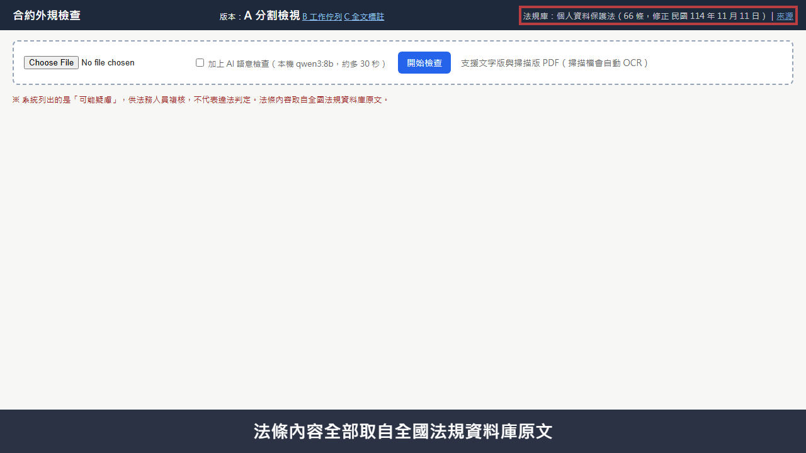
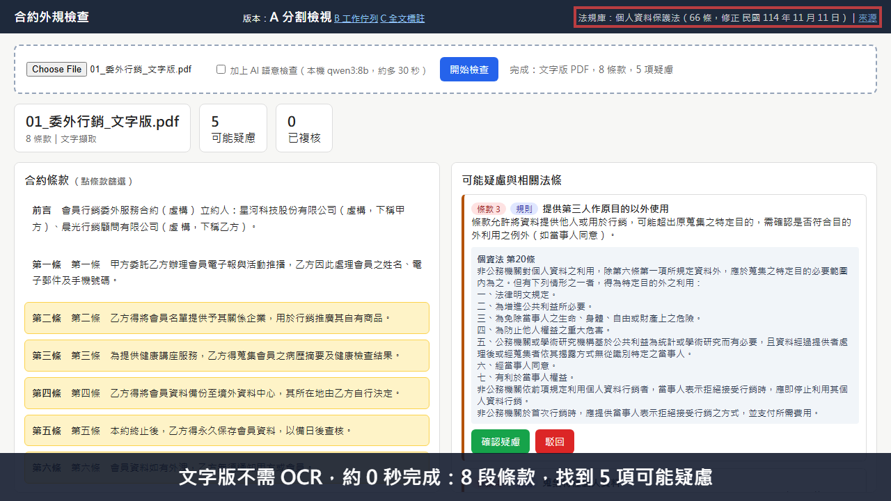
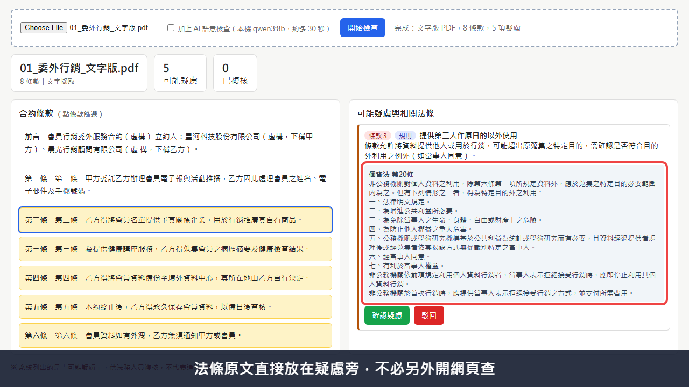
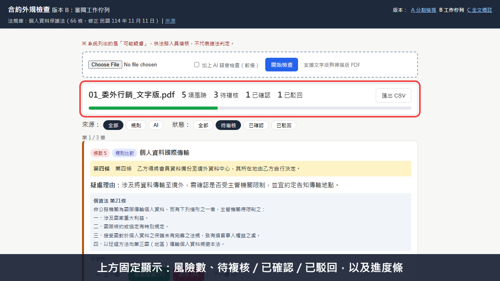
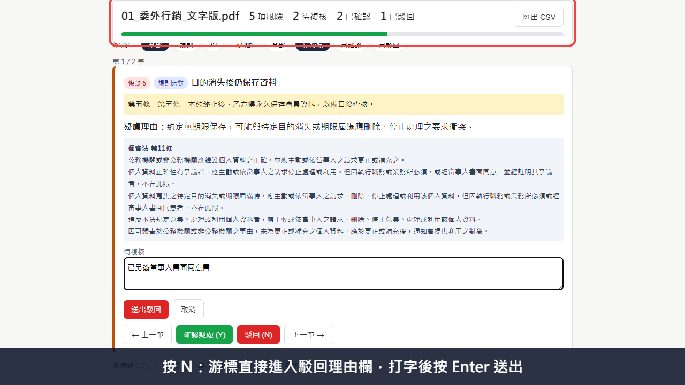
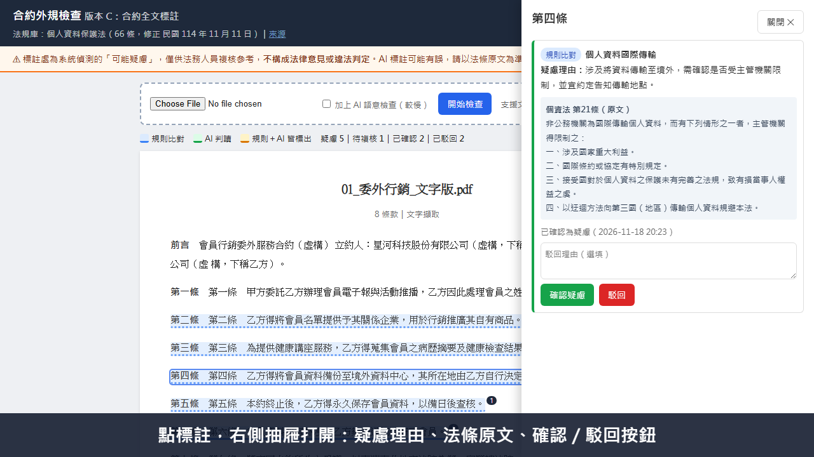
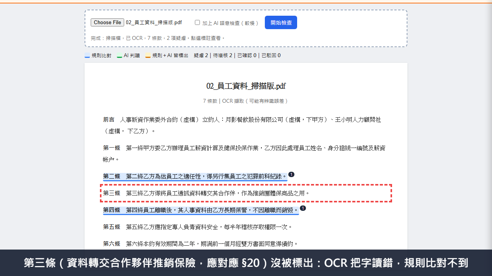
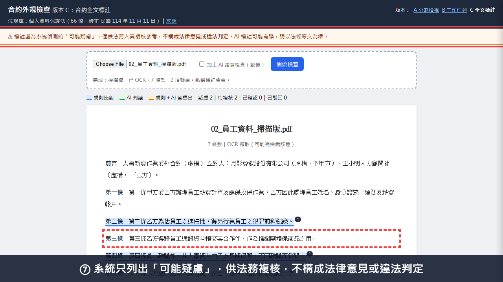

# 合約外規檢查：操作步驟

影片：[操作說明.mp4](操作說明.mp4)（約 105 秒，1280×720）。重新錄製：`py -3.12 docs/video/record.py`（自起 port 8013 隔離伺服器，不動 data/app.db）。

## 步驟 1

版本 A 首頁：上傳區、法規庫資訊（個資法條數、修正日期、來源連結）

## 步驟 2

上傳文字版合約後：5 項可能疑慮，左為條款（黃底＝有疑慮）、右為疑慮與法條

## 步驟 3

點條款篩選：右側顯示該條款疑慮與個資法原文

## 步驟 4

版本 B：摘要列與進度條、一次一筆的待複核卡片

## 步驟 5

按 N 駁回：填寫駁回理由（會留在稽核紀錄），Enter 送出

## 步驟 6

版本 C：點標註開啟抽屜，顯示疑慮理由與法條原文

## 步驟 7

掃描版 OCR 結果：紅框的第三條因 OCR 錯字漏報 §20，需人工複核

## 步驟 8

頁首常駐免責聲明：只提示可能疑慮，不判定違法

