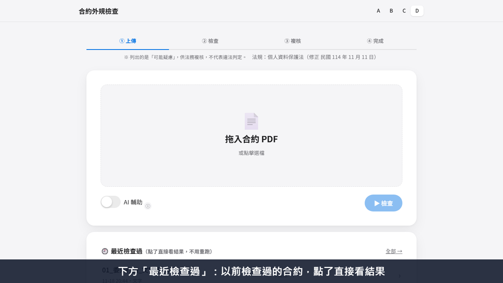
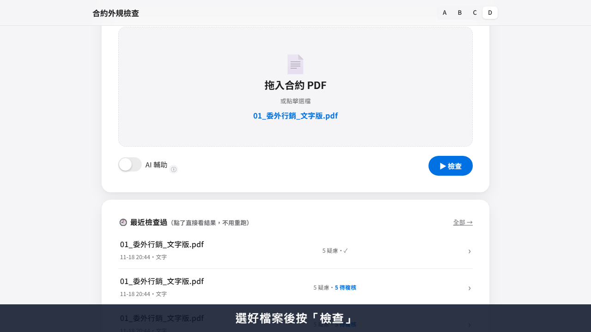
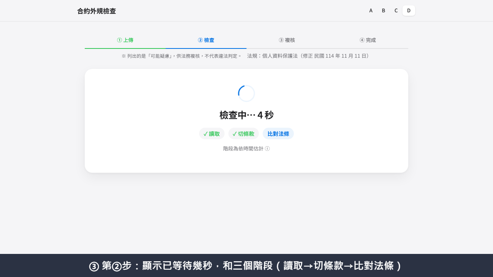
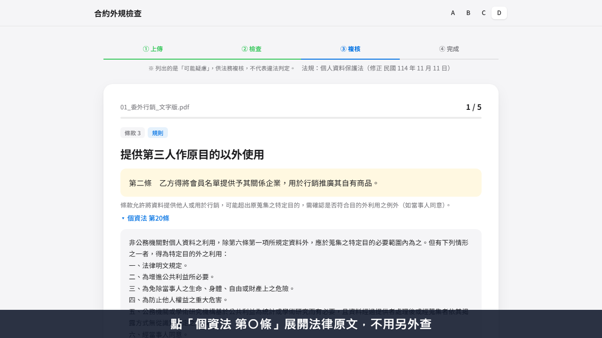
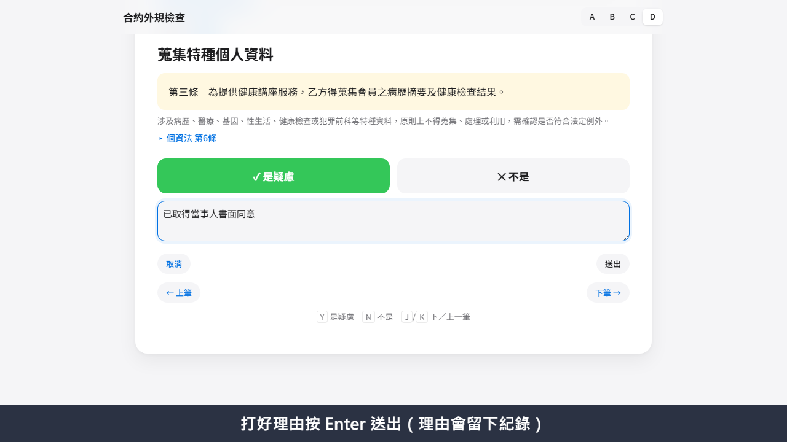
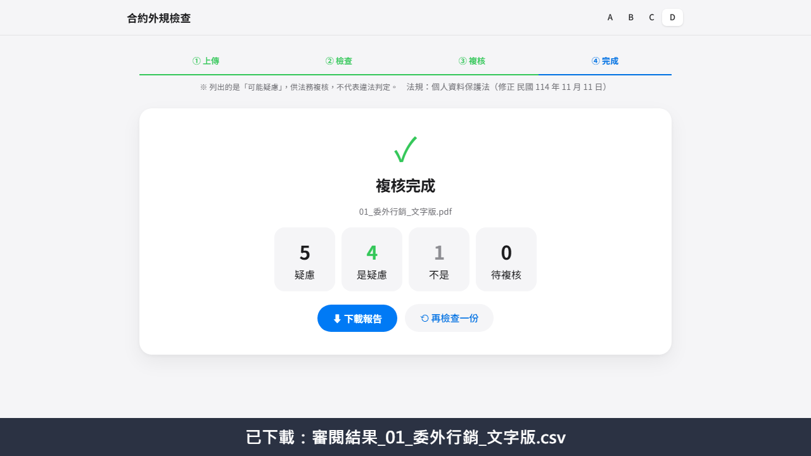
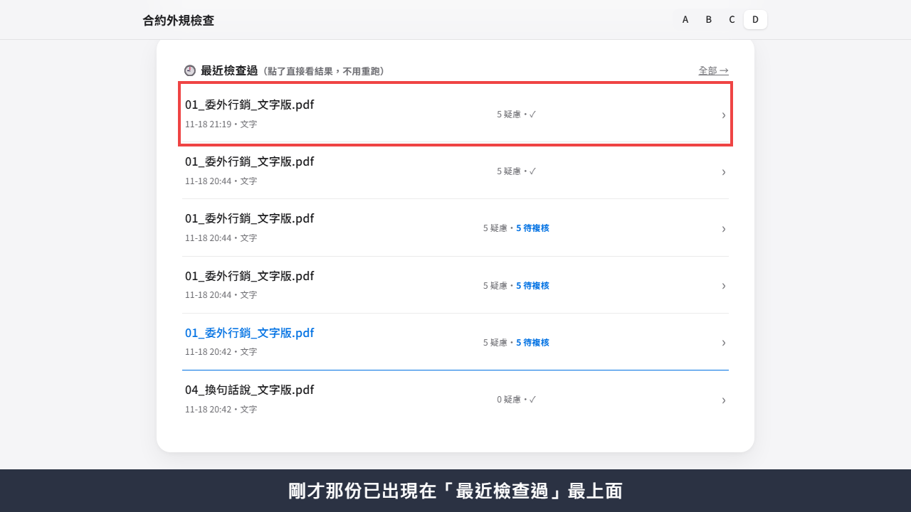
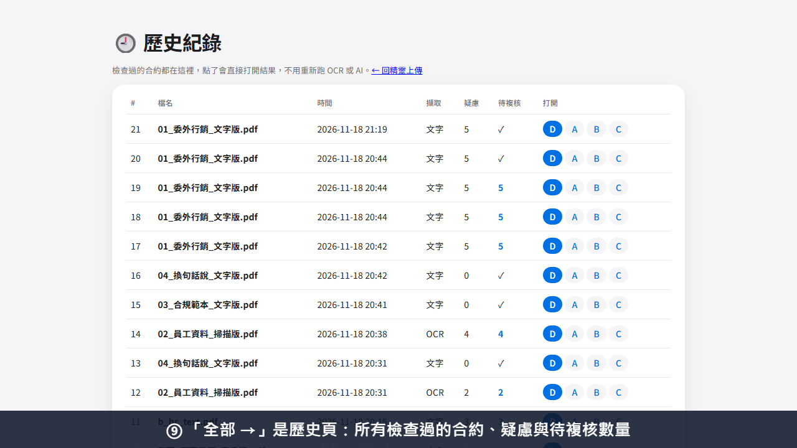

# 精靈版（/v/wizard）操作步驟

影片：[精靈版操作說明.mp4](精靈版操作說明.mp4)

## 1. 精靈版首頁：上方四個步驟，下方「最近檢查過」

## 2. 選好 PDF 後按「▶ 檢查」

## 3. 第②步檢查中：等待秒數與三個階段

## 4. 第③步：一次一題，展開個資法原文

## 5. 按 N 填理由「已取得當事人書面同意」，Enter 送出

## 6. 第④步：統計結果與「下載報告」（CSV）

## 7. 回到首頁：剛檢查的合約在「最近檢查過」第一筆

## 8. 歷史頁：所有檢查過的合約一覽

> 電腦負責提醒，最後由人決定。
